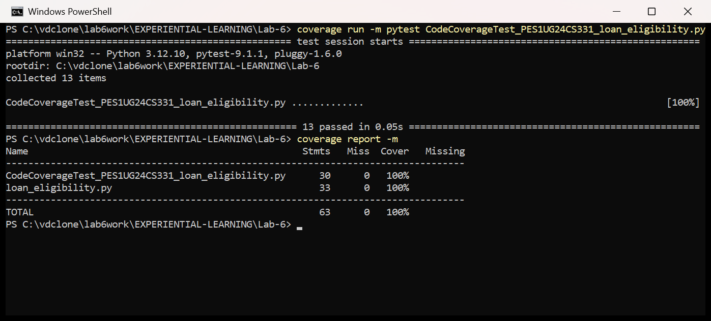
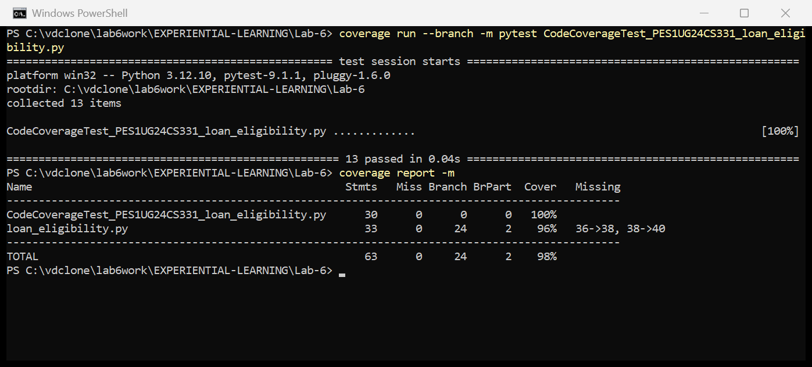
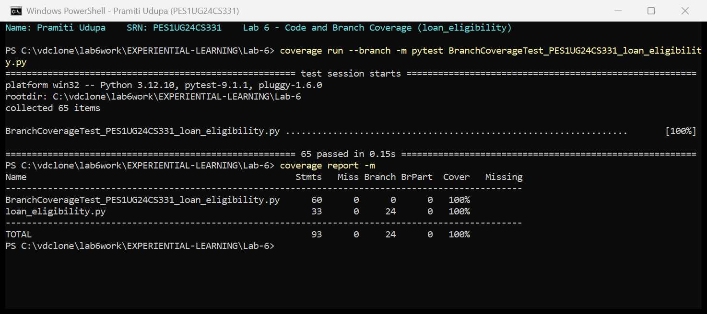
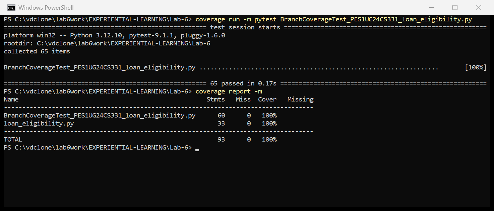

# Lab 6: Code and Branch Coverage Analysis

**Name:** Pramiti Udupa
**SRN:** PES1UG24CS331
**Assigned repository:** [SETAPESU26/L6_L7_26_loan_eligibility](https://github.com/SETAPESU26/L6_L7_26_loan_eligibility)

## Application under test

`loan_eligibility.py` has three functions:

| Function | What it does |
|----------|--------------|
| `credit_band(score)` | Maps a score from 300 to 900 to `excellent` (750 or more), `good` (650 or more), `fair` (550 or more) or `poor`. Any other score raises `ValueError`. |
| `is_eligible(age, income, employment, score)` | Raises `ValueError` for an unknown employment type. Returns `False` if the age is outside 21–60, the income is below the minimum (25000 salaried, 40000 self-employed) or the credit band is `poor`. Otherwise returns `True`. |
| `interest_rate(score, employment, has_collateral)` | Base rate of 8 / 10 / 13 for excellent / good / other bands. Adds 1 for self-employed and takes off 2 when there is collateral. |

## Files

| File | Description |
|------|-------------|
| `loan_eligibility.py` | Application (unchanged from the assigned repo) |
| `test_loan_eligibility.py` | Starter test file from the assigned repo |
| `CodeCoverageTest_PES1UG24CS331_loan_eligibility.py` | Test cases for code (statement) coverage |
| `BranchCoverageTest_PES1UG24CS331_loan_eligibility.py` | Test cases for branch coverage |
| `screenshots/` | Terminal output of the coverage runs |

## Setup

```bash
pip install coverage pytest
```

## 1. Initial coverage (starter tests)

```bash
coverage run -m pytest test_loan_eligibility.py
coverage report -m
coverage run --branch -m pytest test_loan_eligibility.py
coverage report -m
```

| File | Stmts | Miss | Branch | BrPart | Line cover | Branch cover |
|------|------:|-----:|-------:|-------:|-----------:|-------------:|
| `loan_eligibility.py` | 33 | 21 | 24 | 6 | 36% | 32% |

The two starter tests only reach the `excellent` band and the eligible case.
None of `interest_rate()` runs, and every error and rejection path is missed
(lines 6, 9-13, 18, 20, 22, 24, 29-40).

## 2. Code coverage

```bash
coverage run -m pytest CodeCoverageTest_PES1UG24CS331_loan_eligibility.py
coverage report -m
```

13 tests. Each test reaches a statement that was not run before: the invalid
score raise, the good, fair and poor bands, the unknown employment raise, the
age, income and credit rejections, and the three base interest rates.

| Run | Stmts | Miss | Branch | BrPart | Cover | Missing |
|-----|------:|-----:|-------:|-------:|------:|---------|
| Line coverage | 33 | 0 | – | – | **100%** | – |
| Branch coverage | 33 | 0 | 24 | 2 | 96% | `36->38`, `38->40` |





**Analysis:** every line runs, so line coverage is 100%. Branch coverage still
finds two gaps. All three `interest_rate()` tests use `"self_employed"` with
`has_collateral=True`, so:

- `36->38`: the `if employment == "self_employed"` check is never False (a salaried applicant is never priced).
- `38->40`: the `if has_collateral` check is never False (a loan without collateral is never priced).

Line coverage reports 100% here even though the rate for a salaried applicant
without collateral, the most common case, is never checked. That is the false
sense of security the handout describes.

## 3. Branch coverage

```bash
coverage run --branch -m pytest BranchCoverageTest_PES1UG24CS331_loan_eligibility.py
coverage report -m
```

65 tests (parametrised). Every decision is taken both ways, and every boundary
value is checked:

- **`credit_band`**: scores below 300 and above 900 (both halves of the `or`), plus 300, 549/550, 649/650, 749/750 and 900.
- **`is_eligible`**: unknown employment types (including the wrong case, `"Salaried"`), ages 20/21 and 60/61, income one below and exactly at the minimum for both employment types, poor against fair/good/excellent credit, and the order of the checks (employment first, credit score last).
- **`interest_rate`**: all 16 combinations of band × employment × collateral, band boundaries, falsy collateral values (`0`, `None`, `""`) and an invalid score.

| Run | Stmts | Miss | Branch | BrPart | Cover |
|-----|------:|-----:|-------:|-------:|------:|
| Branch coverage | 33 | 0 | 24 | 0 | **100%** |
| Line coverage | 33 | 0 | – | – | **100%** |





**Analysis:** all 24 branches in `loan_eligibility.py` are now taken, with no
partial branches. Coverage.py tracks branches, not conditions, so the
compound conditions on lines 5 and 19 (`score < 300 or score > 900`,
`age < 21 or age > 60`) can show 100% while only one side of the `or` has been
tested. The parametrised tests check both sides of each condition and the
values just inside and just outside every limit.

## Summary

| Stage | Tests | Line coverage | Branch coverage |
|-------|------:|--------------:|----------------:|
| Starter | 2 | 36% | 32% |
| Code coverage tests | 13 | 100% | 96% |
| Branch coverage tests | 65 | 100% | 100% |
